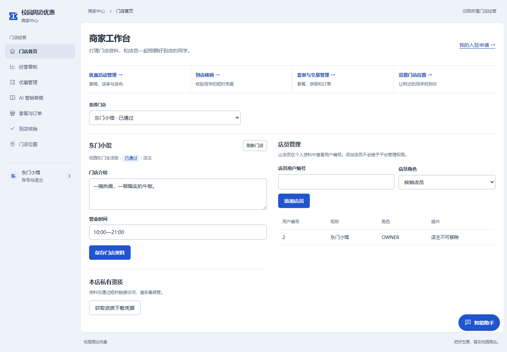
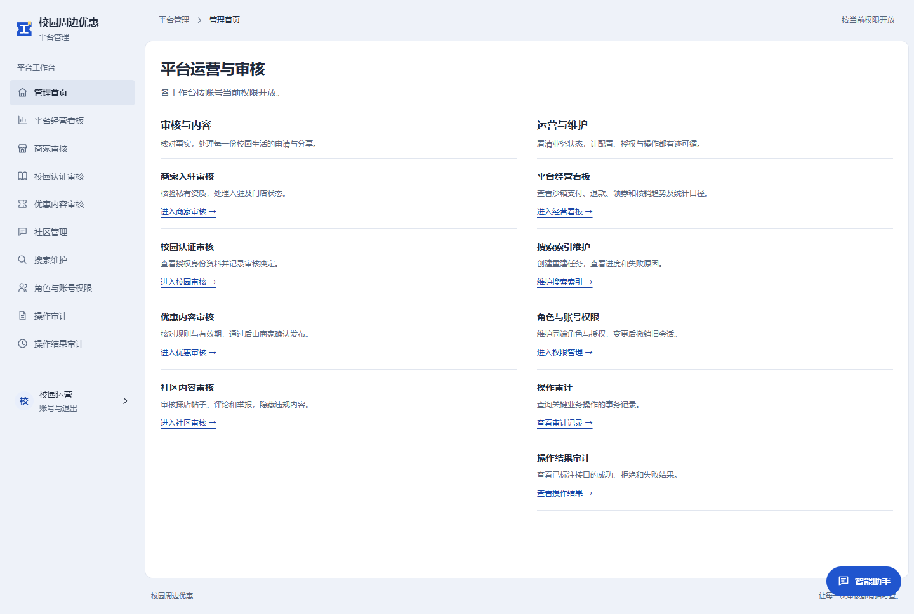

# SchoolPerks · 校园周边优惠

连接同学、周边商家与校园生活的优惠聚合分享平台。围绕发现优惠、领券到店、套餐交易和探店分享，提供用户、商家、管理员三个独立入口。

**项目导航：[前端工程](https://github.com/RainSile/SchoolPerks/tree/campus-frontend) · [后端工程](https://github.com/RainSile/SchoolPerks/tree/campus-backend) · [技术文档](https://github.com/RainSile/SchoolPerks/tree/campus-doc)**

## 分支说明

`main` 用于项目介绍、页面展示与导航；源码和详细工程文档分别维护：

| 分支 | 内容 | 开始使用 |
| --- | --- | --- |
| [campus-frontend](https://github.com/RainSile/SchoolPerks/tree/campus-frontend) | `frontend/`：Vue 3 应用 | [前端 README](https://github.com/RainSile/SchoolPerks/blob/campus-frontend/README.md) |
| [campus-backend](https://github.com/RainSile/SchoolPerks/tree/campus-backend) | `backend/`：Java 多模块服务，附构建验证脚本与部署模板 | [后端 README](https://github.com/RainSile/SchoolPerks/blob/campus-backend/README.md) |
| [campus-doc](https://github.com/RainSile/SchoolPerks/tree/campus-doc) | 架构、接口、数据库、依赖、配置与设计说明 | [文档目录](https://github.com/RainSile/SchoolPerks/blob/campus-doc/README.md) |

前后端各自只在对应分支根目录保留一份项目 README。字体来源说明和许可随前端素材保留。

## 功能概览

| 使用角色 | 主要功能 |
| --- | --- |
| 用户 | 密码／验证码认证、注册与找回密码、校园认证、优惠筛选与领券、券包与到店核销凭据、套餐订单与拼团、探店分享、附近商家、个人助手 |
| 商家 | 门店资料与成员权限、优惠草稿和审核发布、到店核销、套餐与订单管理、私有 AI 营销草稿、经营统计 |
| 管理员 | 商家入驻、校园认证、优惠与社区审核、账号与角色授权、搜索维护、操作审计、平台统计 |

账号所属端、授权范围与资源归属由后端校验。订单金额、库存、支付与核销状态均以服务端结果为准；AI 营销生成内容保存为私有草稿。

## 页面预览

以下为真实前端渲染截图，使用独立测试夹具中的虚构校园、商家与账号数据，不包含真实账号、订单或凭据。截图只展示界面，不代表所有外部服务已经配置。

### 用户端 · 校园优惠布告栏

优惠条件、有效期、库存和领取入口集中展示；图钉、回形针、票根与少量手绘装饰组成校园布告栏风格。


<details>
<summary>商家端 · 门店工作台</summary>

门店资料、团队角色及优惠／交易入口按当前成员权限开放。



</details>

<details>
<summary>管理端 · 运营与审核</summary>

审核、经营统计、角色授权及审计入口按当前平台权限显示。



</details>

<details>
<summary>手机端 · 优惠首页</summary>

手机采用单列票据和折叠式个人菜单，保留校园筛选与领取入口。


</details>

## 技术栈

| 层次 | 技术 |
| --- | --- |
| 前端 | Vue 3、TypeScript、Vite、Vue Router、Pinia、ECharts |
| 后端 | Java 17、Spring Boot 3、MyBatis-Plus、Spring Security、JWT |
| 接口与迁移 | REST、OpenAPI / Knife4j、Flyway |
| 业务数据库 | MySQL 8 |
| 可选基础设施 | Redis、MongoDB、RabbitMQ、Elasticsearch + IK |
| 扩展服务 | AI / LangChain4j、Embedding / Pinecone、MinIO、地图、支付宝沙箱 |

依赖版本由 POM 和 npm 锁文件固定，见[依赖说明](https://github.com/RainSile/SchoolPerks/blob/campus-doc/docs/DEPENDENCIES.md)。可选服务须显式准备资源与配置；仓库不提供真实短信、支付或云服务凭据。

## 获取与运行

前后端可以分别检出到独立目录：

```sh
git clone --branch campus-frontend --single-branch https://github.com/RainSile/SchoolPerks.git schoolperks-web
git clone --branch campus-backend --single-branch https://github.com/RainSile/SchoolPerks.git schoolperks-api
```

前端需要 Node.js 22.12+，后端需要 JDK 17 和 Maven 3.6.3+。进入各工程后按其根目录 README 配置并构建；后端默认 skeleton profile 不连接数据库，启用完整业务需配置独立数据库与认证密钥。

## 许可证

项目沿用 [Apache License 2.0](LICENSE)。第三方字体按随附的 OFL 许可分发，来源与派生说明见[前端字体记录](https://github.com/RainSile/SchoolPerks/blob/campus-frontend/frontend/public/fonts/README.md)。

<!-- campus-release-20261026-start -->
## 最近更新

智能助手新增真正的流式输出、安全 Markdown、多步业务操作和明确的角色权限。平台管理员可在显式授权后跨端调用业务 API，个人会话继续隔离。

本轮修复搜索重建测试隔离、管理员跨端二次校验与内部守卫等问题，188项后端检查、11组浏览器检查、真实优惠/地图旅程及真实模型四条链路通过。MinIO已在2026-10-27完成下述真实存储专项；真实短信、支付宝沙箱及其他未覆盖分支仍需专项验收。

[助手业务 API 与权限](https://github.com/RainSile/SchoolPerks/blob/campus-doc/docs/ASSISTANT-BUSINESS-APIS.md) · [业务测试与修复报告](https://github.com/RainSile/SchoolPerks/blob/campus-doc/docs/BUSINESS-TEST-RESULTS.md)
<!-- campus-release-20261026-end -->

<!-- campus-minio-20261027-start -->
## MinIO已接入

商家资质和社区图片已接入私有MinIO，支持真实上传、封存与权限控制下载。轻量部署使用256MiB内存上限、1GiB桶配额，实测约106MiB；发布前30项相关检查通过，数据库56表摘要一致。

[部署与业务验证](https://github.com/RainSile/SchoolPerks/blob/campus-doc/docs/MINIO-SETUP.md) · [后端部署模板](https://github.com/RainSile/SchoolPerks/blob/campus-backend/deploy/minio/README.md)
<!-- campus-minio-20261027-end -->
