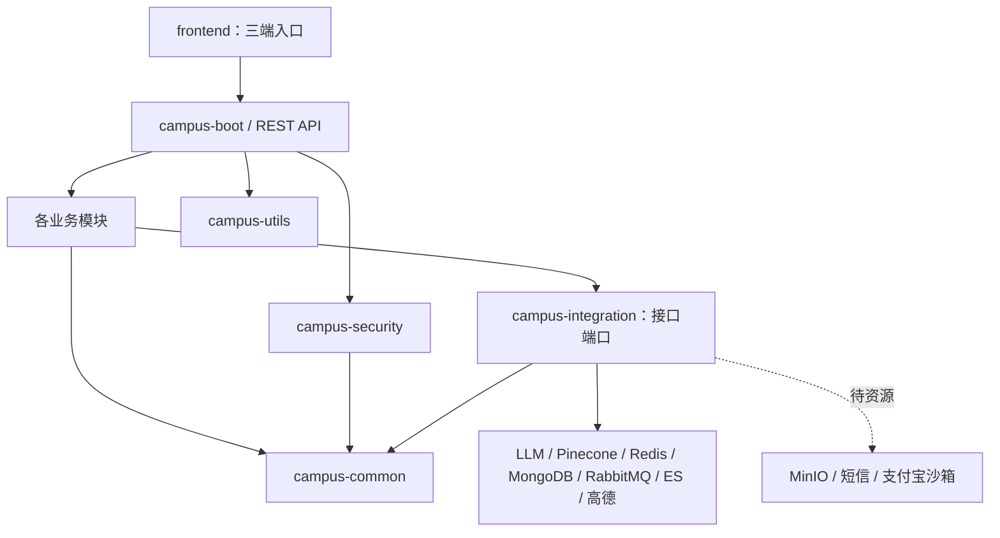

# 架构与模块职责

2026-10-23第七阶段补充：campus-analytics只读boot迁移管理的统计视图，账号/会话/门店守卫通过端口；Java生成时区日界线并使用REPEATABLE_READ聚合，有界短期进程缓存始终在权限检查之后。campus-security提供白名单@AuditedOperation/OperationAuditPort，campus-admin持久化和查询结果；不引入security→integration循环，不新增AspectJ版本。原业务事务AuditPort保持严格原子性，辅助结果审计单独记录成功/拒绝/失败且不保存输入正文。详见BUSINESS-RULES.md。

2026-10-23第六阶段补充：营销草稿及交互预算位于campus-assistant，跨域规则通过integration的PromotionFactsPort/PublicContentPort/MerchantAccessPort读取，不直接访问coupon/merchant Mapper。模型经AiModelPort调用，不暴露SDK类型。生成计划/结果确认使用SQL短事务，外部请求在事务外，最终重查会话、门店、公开事实和租约；所有结果只落私有草稿。原悬浮助手保持只读工具，详情见BUSINESS-RULES.md。

采用模块化单体：一个后端进程、一套主数据库、一个包含三端入口的 Vue 应用。先在模块边界内完成业务闭环，再按需接入外部基础设施。

## 模块

| 后端模块 | 职责 | 后续重点 |
| --- | --- | --- |
| campus-common | 分页、异常、枚举、业务配置 | 保持通用，不反向依赖业务 |
| campus-utils | 无状态工具，现有时间范围值对象 | 不放鉴权、库存等业务规则 |
| campus-security | JWT 签发/验签、实时会话校验、方法权限、CORS | 通过端口访问用户模块的会话状态 |
| campus-integration | 外部能力端口、配置契约、可选 SDK | MinIO、LangChain4j、Pinecone、消息适配器 |
| campus-user | 验证码登录、自动注册、会话/刷新、校园认证及审核端口、本人资料 | 已实现；真实短信供应商待提供 |
| campus-file | 私有资质元数据、上传确认、所有权、短时凭据 | 业务已实现；MinIO 适配器待资源 |
| campus-merchant | 入驻快照、门店、店员、分类、发布资格、WGS84位置/附近查询 | 高德展示/安全代理已接入；菜品后续 |
| campus-coupon | 草稿/审核发布、结构化规则、领取、短时二维码、核销 | 已实现MySQL事务版；Redis/MQ异步优化后续 |
| campus-notification | outbox、租约重试、本人收件箱、WebSocket | 单实例已实现；跨节点分发后续 |
| campus-trade | 套餐/秒杀、拼团、订单、超时取消、支付状态、退款/核销 | 本地状态机已实现；真实沙箱待资源联调 |
| campus-community | 图文/不可变审核、评论、点赞、举报与隐藏 | MySQL已实现；Mongo迁移需跨库命令契约 |
| campus-search | 公开投影、增量事件、持久重建、安全高亮 | MySQL与真实ES8+IK已验证，Pinecone公开投影 |
| campus-assistant | 私有会话、RAG及身份工具 | 真实模型/只读工具、私有营销草稿及交互调用预算已实现 |
| campus-admin | 两种审核入口、关键操作审计查询 | 审核/审计已实现；RBAC归账号所属的campus-user |
| campus-analytics | 商家/平台看板、时区窗口、精确金额及短期缓存 | 已完成；UV未采集，性能对比待独立环境 |
| campus-boot | 启动、跨模块装配、配置、迁移 | 不承载业务逻辑 |

Maven 模块与 npm 包使用 `campus-` 前缀。Java 包名不能含 `-`，统一为 `com.campus.perks.<功能>`。业务模块预留 `mapper/dto/vo/entity/controller/service/serviceImpl` 七层包，保留用户要求的 `serviceImpl` 拼写；检索模块已实现投影/重建的entity与mapper；看板已实现entity/mapper聚合层；不将未采集UV或未执行性能实验虚构为完成。

## 依赖方向

Controller 处理 DTO 校验、HTTP 状态及资源位置；Service 处理业务规则、数据权限与事务；Mapper 只访问本模块表；VO 不暴露实体、密码摘要、身份证、完整手机号或资质地址。

跨域查询的明确例外是boot迁移管理的公开只读视图：campus_coupon_catalog、campus_trade_catalog、campus_post_catalog、campus_search_source。它们组合公开字段并实时过滤权限/状态，业务只读视图，不跨模块引用Mapper或写其他模块表。第七阶段另有5个私有统计只读视图campus_analytics_event/claim/order/merchant/account，只有经过后端平台或门店范围守卫的analytics可读取，不作为公开目录。outbox表运行实现归notification模块。

禁止跨模块引用 Mapper。当前小型跨域端口放在 `campus-integration`，由业务模块实现、boot 装配，避免 user→merchant→user 环。持久化审计是 admin 的 AuditPort 实现，要求加入调用方事务；关键操作审计失败即回滚业务。不要复制各模块的配置类、响应包装或 JWT 工具。

## REST、身份与配置

接口前缀 `/api/v1`，集合采用复数名词。创建返回 201 和 Location，异步受理返回 202 与任务资源，删除成功返回 204。错误使用真实 HTTP 状态和 RFC 9457 ProblemDetail；成功响应直接是 VO 或 `items/total/page/size` 分页资源。

协议名称、路由、枚举等稳定常量可以写在代码中；地址、密钥、模型名、向量维度、超时、业务限额必须配置化。业务层注入 BusinessProperties 与 Clock，不能散落默认密码或固定 Token。`couponClaimLimit=1` 与 V1 唯一约束一致，开放多次领取必须同步迁移表结构。

身份来自验签 JWT 的 `sub`。认证开启时忽略JWT中的权限快照，按数据库的account_type与实时授权计算PORTAL及操作权限，并核对sid、用户状态和access_version。商家 ID 还必须结合当前用户的门店成员关系校验。JWT 检查issuer/audience/exp/sub；签发、刷新轮换、重放撤销、注销、封禁及授权版本变化即时生效。权限与状态查询绕过MyBatis缓存。不得添加“开发管理员”或放行全部接口。

所有发布的 Controller 提供 `@Tag`、`@Operation` 和响应说明；DTO 使用 Jakarta Validation。公开业务 ID 传字符串；金额使用 BigDecimal/DECIMAL；时间以 UTC 存储和传输，前端按用户时区显示。

## 外部能力

当前默认仅MySQL在local profile启用。Redis/Mongo/Rabbit使用Boot管理的直接客户端，LangChain4j真实聊天/独立Embedding普通依赖，ES/Pinecone/高德使用受限HTTP适配器；显式开关开启，凭据不全则失败。无对应starter自动探测默认地址，MongoAutoConfiguration显式排除。MinIO/短信仍不可用；不自动建云索引。

- 对象存储：仅引用 ObjectStoragePort。资质私有、短时签名 URL，对象 key 由服务端生成并绑定用途与所有者。
- AI：业务通过AiModelPort/VectorSearchPort/ConversationStorePort/RateLimitPort访问供应商。当前已接DeepSeek、独立Qwen1024维、Pinecone Documents2026-07、Mongo历史和Redis限流。RAG候选从主库重新验证公开状态/哈希；只读白名单工具走当前Bearer的本机真实API。SQL命令租约与Mongo attempt分别防旧worker确认/覆盖。
- 领券：当前仍为同步MySQL事务。未来Redis预占需要持久reservationId/requestId、查询状态及补偿；Redis限流和Rabbit通知接入不能当作异步领券已完成。
- 交易：金额来自服务端快照；回调验签并验证金额和订单；支付与超时取消通过条件更新竞争，同一订单只释放库存一次。RabbitMQ TTL+DLX 或延迟插件须明确选择，不能假定插件存在。
- 核销：事务内校验门店、有效期与状态，条件更新 AVAILABLE→REDEEMED，记录核销和 outbox；提交后推送 WebSocket，通知失败不回滚核销事实。
- 检索：ES/Pinecone都是可重建投影。ES使用external_gte版本防覆盖；Pinecone重读主库投影，读取时必须校验最新公开状态/哈希，不能假设它支持外部版本。ES与IK完整版本匹配。
- 社区：当前帖子/评论/点赞均在MySQL事务内；CommunityInteractions隔离互动持久化。未来Mongo必须补持久命令/outbox、幂等消费、操作查询和计数对账，不能直接同步双写假设跨库原子性。

## 前端

`frontend/src/campus-features/campus-<功能>` 按业务放 API、类型、页面与组件；`campus-shared` 放请求层和配置；`campus-stores` 放 Pinia；`campus-router` 管理三端路由。

用户首页公开，账号与校园认证页面要求登录；商家和管理工作台要求对应权限。已实现路由守卫及按当前权限展示导航，完整 RBAC 管理仍在后续阶段。前端权限负责体验，后端负责最终授权。用户 H5 不全局绑定 Element Plus 后台布局。

认证阶段新增依赖方向 campus-user → campus-security → campus-common。反向调用会话状态通过 security 的 SessionStatePort 接口由 user 实现，因此没有 Maven 循环依赖。短信发送通过 integration 的 SmsSenderPort 替换。当前 OTP/限频/会话使用 MySQL 行锁与事务；尚不依赖 Redis，之后替换存储时须保留现有安全语义。

## 第二阶段边界

`campus-file/merchant/admin` 使用既有 security/integration/common；user 通过 security 的 PermissionContributor 聚合真实门店关联，权限检查绕过 MyBatis 缓存。审核员只经申请关联签发资质凭据；不能任意指定其他人的 fileId。校园身份原文需要 campus:review，单独读取并审计、no-store；审核列表不含身份。

入驻/确认上传先锁用户，再锁申请/文件；门店编辑、成员变更、状态变更与发布资格检查锁门店。优惠写事务应复用该锁，以串行化发布与暂停。门店更新只开放 description/businessHours + version；名称、学校、分类、地址和资质的变更需后续单独审核设计。

ObjectStoragePort.seal 必须从临时上传对象复制到独立封存对象并返回封存内容的实际大小、MIME 和文件头；封存 key 永不提供上传链接。SQL 与对象存储不是分布式事务，重试和孤儿对象清理须由后续适配器设计。当前文件头检查不是病毒扫描。

## 第三阶段实现

coupon与notification只依赖common/security/integration，不直接依赖merchant/user/admin模块。跨域授权通过MerchantAccessPort和AccountDirectoryPort；审核入口属于coupon功能Controller，通过coupon:review授权。临时核销码使用32字节随机秘密，只存SHA-256摘要，SVG二维码由ZXing生成。

账号（涉及多人时按数值ID排序）→门店→优惠→券/审核请求是写事务锁顺序；带锁查询直接返回完整门店当前行，成员角色FOR SHARE并绕过缓存，避免REPEATABLE READ旧快照和缓存导致已暂停/已撤权仍放行。审计和outbox写失败回滚业务；核销限频的预期错误只提交计数。

outbox租约领取与确认分别使用短事务，投递在事务外。持久通知按事件/用户唯一去重，先落收件箱，再尝试向本人连接发送。客户端首帧认证，不接受任意用户订阅，定期校验真实会话；断线后用HTTP恢复。第三阶段COUPON_REDEEMED与第四阶段7种ORDER事件均有明确处理器，连接路由仍为单实例，不假设任意事件或多实例消息已可用。

## 第四阶段实现

trade依赖common/security/integration和Boot管理的Spring JDBC；其Mapper只访问交易表与boot迁移定义的公开campus_trade_catalog视图，不跨域引用Mapper。跨域门店/账号检查、事务审计和outbox继续通过端口。套餐价格和订单内容快照不可变；客户端不能传入结算金额。

写事务沿用账号升序→门店（需授权时）→套餐→团→订单→支付/退款的锁顺序。路由预读只取不可变关联，后续以FOR UPDATE当前行判断可付款、取消、核销或退款；支付/退款和核销码读取也不使用旧RR快照。团成功/失败先持久化，再逐单结算，避免锁团后反向锁其他账号。库存预占和stock_released条件归还均与订单状态/审计/outbox同事务。

integration提供只允许官方沙箱域名的AlipaySandboxAdapter。创建支付链接仅本地签名；后台查单、关闭、退款调用位于事务外。回调先验RSA2及app/seller，再事务校验金额/订单/交易号及通知去重。退款使用稳定out_request_no、租约和退避，远端成功本地失败可用原编号恢复。默认资源未提供时503，不引入运行时Mock。详见BUSINESS-RULES.md和DEPENDENCIES.md。

## 第五阶段实现

社区写事务使用READ_COMMITTED，按账号升序→关联门店→帖子→审核/评论顺序锁定当前状态；审核快照不可变。图片复用FileAccessPort与用途/所有权检查。公开响应通过只读视图即时过滤作者/门店，审核原因仅私有管理响应返回。位置功能在merchant模块内，仅明确WGS84位置参与SQL直线距离排序，客户位置不落库。

SearchChangeEvents在业务事务中写outbox，聚合键为SEARCH:类型:ID；NotificationPublisher明确路由SearchProjectionPort。投影消费者在独立短事务中递增revision、重读公开主库源，远端HTTP移出事务，成功后才消费去重；隐藏保留空正文墓碑。搜索结果按主库公开范围/内容哈希重新校验，防止索引滞后泄露隐藏或旧正文。重建为可恢复游标任务，租约token防旧worker推进，远端external_gte防旧版本覆盖。

SearchEnginePort由MYSQL默认不可用远端实现或显式ES8 REST适配器提供；本地搜索由SearchMapper查询真实投影。Mongo当前用于助手历史，高德进入附近页面后自动加载并转换展示坐标。清单修复及当前真实资源状态见CONFIGURATION.md，原第五阶段历史见SEARCH-SETUP.md。
